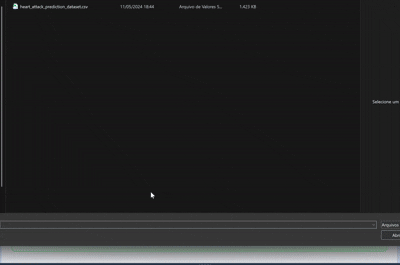
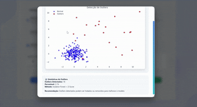
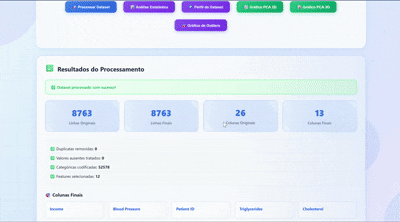

# ✨ CleanSight

🔍 **CleanSight** é uma plataforma interativa de pré-processamento de dados que transforma arquivos brutos em datasets prontos para análise e modelagem de machine learning. Com uma interface moderna e endpoints robustos, ela permite upload, análise, limpeza e visualização de dados diretamente no navegador.

---


<p align="center">

  
  
  
</p>

## 📦 Funcionalidades

- 📁 **Upload inteligente de datasets** (CSV, TXT, TSV)
- 🔍 **Análise automática** de encoding, delimitadores e tipos de dados
- 🧹 **Tratamento de valores ausentes**
- 🧬 **Codificação de variáveis categóricas e booleanas**
- 🧮 **Normalização de variáveis numéricas**
- 🧠 **Seleção de features mais relevantes**
- ⚖️ **Balanceamento de classes**
- 🧊 **Remoção de duplicatas**
- 📈 **Gráficos de PCA 2D/3D baseados na coluna target**, correlação e outliers
- 📝 **Perfilamento completo do dataset** (pandas profiling)
- 💾 **Download do dataset processado**
- 🌐 **API RESTful** com múltiplos endpoints úteis

---

Em um mundo orientado por dados, a qualidade do seu dataset é o alicerce para qualquer análise ou modelo de Machine Learning bem-sucedido. O CleanSight aborda essa necessidade crítica, oferecendo uma solução completa que vai desde a importação inteligente de dados até a exportação de um dataset limpo e otimizado.

### Pipeline de Funcionalidades

| Etapa | Funcionalidade | Descrição |
| :--- | :--- | :--- |
| **1. Ingestão Inteligente** | Upload e Leitura de Dados | O CleanSight lida com a complexidade da importação de dados, suportando arquivos `.csv`, `.txt` e `.tsv`. Nossa tecnologia de detecção automática de encoding e delimitador garante que seus dados sejam lidos corretamente, independentemente da formatação. <br><br>  |
| **2. Diagnóstico Profundo** | Análise Inicial do Dataset | Com um único clique, obtenha um diagnóstico completo do seu dataset. O CleanSight analisa a estrutura, detecta tipos de dados, quantifica valores ausentes e duplicados, e fornece uma pontuação de qualidade de dados, juntamente com recomendações acionáveis para otimização. |
| **3. Transformação Avançada** | Pré-processamento de Dados | Refine seus dados com um arsenal de ferramentas de pré-processamento. Desde o tratamento de valores ausentes e a remoção de duplicatas até a codificação de variáveis categóricas, normalização e balanceamento de classes, o CleanSight prepara seus dados para os mais exigentes modelos de Machine Learning. <br><br>  |
| **4. Visualização e Insights** | Relatórios e Gráficos | Explore seus dados visualmente com gráficos interativos de Análise de Componentes Principais (PCA) em 2D e 3D, detecte outliers com precisão e gere relatórios estatísticos detalhados. O CleanSight transforma dados brutos em insights visuais claros e acionáveis. <br><br>  |
| **5. Exportação Pronta para Uso** | Download de Dados Processados | Exporte seu dataset limpo e processado com um único clique. O arquivo resultante está pronto para ser consumido por suas ferramentas de análise favoritas ou para treinar seus modelos de Machine Learning. |


## 🛠️ Tecnologias Utilizadas

| Camada     | Tecnologias                 |
|------------|-----------------------------|
| Backend 🧠 | Python, Flask               |
| Frontend 💻 | HTML5, CSS3, JavaScript     |
| Estilo 🎨  | Tailwind-like custom CSS     |
| Outros 🔧  | Matplotlib, NumPy, chardet   |

---

## 🚀 Como Executar Localmente

### 1. Clone o repositório
```bash
git clone https://github.com/seu-usuario/cleansight.git
cd cleansight
```

### 2. Crie um ambiente virtual e instale as dependências
```bash
python -m venv venv
source venv/bin/activate  # ou `venv\Scripts\activate` no Windows
pip install -r requirements.txt
```

> 📦 Certifique-se de que o arquivo `requirements.txt` contenha:
```txt
Flask
chardet
matplotlib
numpy
pandas
ydata-profiling
plotly
scikit-learn
```

### 3. Execute o servidor Flask
```bash
python main.py
```

### 4. Acesse no navegador 🌐
```
http://localhost:5000
```

---

## 🎯 Endpoints Disponíveis

| Método | Rota             | Função                                 |
|--------|------------------|----------------------------------------|
| POST   | `/api/upload`    | Faz upload do dataset                  |
| POST   | `/api/analyze`   | Analisa a coluna target e qualidade    |
| POST   | `/api/process`   | Realiza o pré-processamento completo   |
| POST   | `/api/statistics`| Estatísticas e perfilamento do dataset |
| POST   | `/api/pca`       | Gera gráfico PCA 2D                    |
| POST   | `/api/pca3d`     | Gera gráfico PCA 3D interativo         |
| POST   | `/api/outliers`  | Detecta e visualiza outliers           |
| GET    | `/api/download`  | Baixa o dataset processado             |
| POST   | `/api/clear`     | Limpa arquivos e estado da sessão      |

Para ver um relatório detalhado com o **pandas profiling**, utilize a rota
`/api/statistics` ou clique em **Perfil do Dataset** na interface.

---

## 📸 Exemplos Visuais







---

## 🧠 Sugestões de Uso

- 💡 Ideal para cientistas de dados em fase de exploração de dados
- 🎓 Perfeito para projetos acadêmicos com foco em aprendizado de máquina
- 🏢 Útil para empresas que precisam preparar dados antes da modelagem

---

## 👤 Autor

**Vinicius Santos**  
Engenheiro da Computação • Cientista de Dados 

[🔗 LinkedIn](https://www.linkedin.com/in/vinicius-santos)  
[🐙 GitHub](https://github.com/ViniciusKanh)

---

## 📃 Licença

Este projeto está licenciado sob a **MIT License**.  
Sinta-se livre para usar, modificar e compartilhar. 🚀
